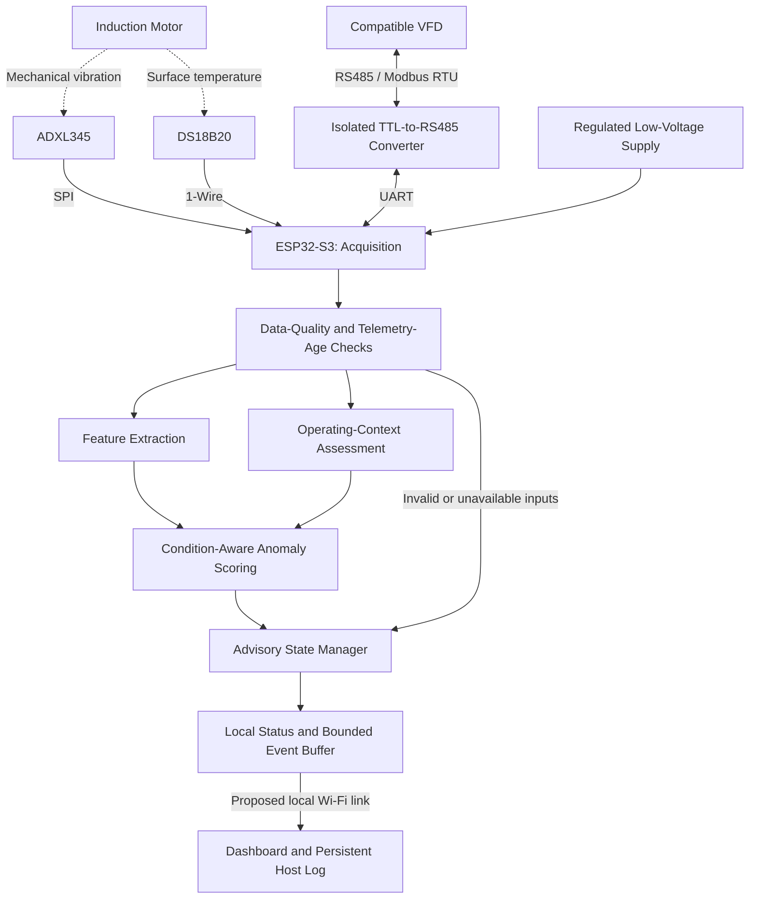
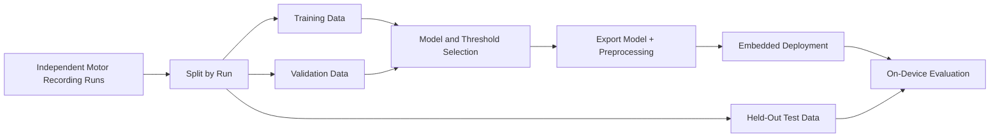

# VibraAid — System Architecture

## 1. Purpose

VibraAid is a proposed condition-aware motor-monitoring system combining
vibration, surface temperature, and available VFD operating-context data.

The system aims to distinguish normal operating variations from abnormal
motor behaviour using local feature processing and anomaly detection.

Development status: proposed architecture; integration and validation pending.

## 2. System Scope

### Included in the Preliminary Design

- Three-axis vibration acquisition
- Motor-surface temperature monitoring
- Operating-context acquisition from a compatible VFD
- Local signal-quality checks and feature extraction
- Condition-aware anomaly scoring
- Advisory status and event logging
- Dashboard visualization

### Not Included in the Initial Scope

- Automatic motor start, stop, or speed control
- Safety-critical motor protection
- High-rate motor-current or voltage-waveform acquisition
- Guaranteed identification of specific fault types
- Remaining useful life prediction
- Validated deployment across different motor installations

## 3. Architecture Overview



The diagram shows functional data paths, not a verified circuit schematic.
The isolated converter must preserve both signal and power isolation.

## 4. Hardware Subsystems

| Subsystem | Proposed Hardware | Interface | Purpose |
|---|---|---|---|
| Edge processing | ESP32-S3-DevKitC-1 N8R8 | SPI, UART, GPIO, Wi-Fi | Acquisition and local analysis |
| Vibration sensing | ADXL345 breakout | SPI | Three-axis acceleration |
| Temperature sensing | DS18B20 probe | 1-Wire | Surface-temperature trend |
| Drive telemetry | Compatible VFD | RS485 / Modbus RTU | Available operating-context data |
| Isolation | Isolated TTL-to-RS485 converter | UART ↔ RS485 | Separate controller and field interface |
| Power | Regulated low-voltage supply | Board-dependent distribution | Monitoring electronics |
| User interface | Local computer running Streamlit | Local network | Visualization and event review |

Exact component variants, logic levels, pin assignments, and power
requirements must be checked against the purchased hardware.

## 5. Measurement Boundaries

### Vibration

The ADXL345 will measure acceleration at a fixed motor-mounting location.
Mounting orientation, attachment method, range, and acquisition settings
must be recorded with each dataset.

### Temperature

The DS18B20 will measure temperature at its mounting location on the
motor surface. This is not a direct measurement of winding temperature.

### VFD Operating Context

The system will read only parameters available in the actual VFD manual,
such as output frequency, reported current, reported voltage, or drive status.

- Reported VFD frequency is not directly measured shaft RPM.
- A load indicator is used only if its meaning and scaling are documented.
- Slowly polled telemetry is not an electrical waveform.
- The initial system will not claim motor-current signature analysis.

## 6. Proposed Acquisition Configuration

These are design targets, not measured performance.

| Parameter | Proposed Setting |
|---|---|
| Vibration output rate | 1,600 samples/s per axis |
| SPI clock | 2 MHz |
| Vibration window | 2,048 samples per axis |
| Window duration | 1.28 seconds |
| Temperature update | Approximately once per second |
| VFD polling | Approximately once per second, subject to drive constraints |
| Window overlap | Initially none; evaluate later |
| Processing target | ≤200 ms after a complete window is available |

Total advisory latency also includes window acquisition, scheduling,
communication, and persistence checks.

## 7. Firmware Organization

### Acquisition Layer

Responsibilities:

- Initialize sensors and communication interfaces.
- Acquire vibration samples into bounded buffers.
- Detect buffer overflow and missing samples.
- Read temperature without blocking vibration acquisition.
- Poll the VFD using documented read operations.
- Timestamp measurements and communication outcomes.

### Quality-Control Layer

Responsibilities:

- Check sensor responses and invalid readings.
- Detect clipping, missing data, and acquisition interruptions.
- Evaluate telemetry age.
- Flag unavailable required inputs.
- Prevent invalid data from producing a normal-condition status.

### Feature Layer

Candidate features:

- Per-axis RMS acceleration
- Crest factor
- Kurtosis
- Selected spectral-band energy
- Temperature and temperature trend
- Available VFD operating-context values

Preprocessing, units, feature ordering, scaling, and numerical safeguards
must be identical during offline evaluation and embedded inference.

### Inference Layer

Responsibilities:

- Load the selected model and preprocessing configuration.
- Check whether the operating condition is within validated coverage.
- Calculate an anomaly score.
- Apply thresholds established using held-out validation recordings.
- Record model and configuration versions.

### State and Reporting Layer

Responsibilities:

- Apply persistence and recovery logic.
- Maintain explicit advisory states.
- Buffer events within available memory.
- Publish status to the dashboard.
- Report resets, data gaps, and communication loss.

## 8. Model Development and Deployment



### Candidate Approach

Evaluate a lightweight statistical baseline and a small feature-based
anomaly-detection model trained on healthy recordings.

A conditional autoencoder is one candidate, not a finalized or already
validated implementation.

### Deployment Rules

- Train models offline.
- Keep test recordings separate from model and threshold selection.
- Keep overlapping windows from the same run in one partition.
- Benchmark memory use and processing latency on the actual controller.
- Verify numerical agreement between offline and embedded processing.
- Do not automatically retrain the baseline during evaluation.
- Do not interpret anomaly scores as calibrated fault probabilities.

If the chosen model exceeds embedded resources, use a smaller model or
the statistical baseline and document the change.

## 9. Advisory States

| State | Trigger | Intended Response |
|---|---|---|
| Initializing | Startup or restart checks incomplete | Show unavailable status |
| Within Learned Range | Valid data within evaluated operating coverage | Display measurements and status |
| Inspection Advised | Persistent anomaly under valid conditions | Record event and request technician review |
| Sensor Fault | Required sensor data invalid or missing | Suspend affected diagnostic scoring |
| Context Unavailable | Required VFD data stale or missing | Suspend context-dependent scoring |
| Outside Validated Range | Operating condition outside evaluated coverage | Avoid a healthy-condition claim |

“Within Learned Range” does not guarantee absence of faults.

Any reduced-input operating mode requires separate validation. Missing
VFD context must not silently trigger an unvalidated vibration-only mode.

## 10. Dashboard and Logging

### Proposed Dashboard Content

- Connection and sensor status
- Latest vibration features
- Surface-temperature trend
- Available VFD operating context
- Anomaly score and advisory state
- Data age and last successful update
- Event history and model version

### Proposed Event Fields

```text
device_id
boot_id
event_sequence
timestamp_utc_if_synchronized
uptime_ms
sensor_status
context_age_ms
operating_context
feature_values
anomaly_score
advisory_state
model_version
configuration_version
```

### Storage Strategy

- Use a bounded on-device buffer for recent events.
- Persist received records on the dashboard computer.
- Document buffer capacity, overflow behaviour, and data gaps.
- Do not claim full raw-waveform storage on the controller.
- Establish a separate recording route for experimental raw data.
- Mark wall-clock timestamps as unavailable until time is synchronized.

Loss of dashboard connectivity must not stop local acquisition and
scoring, but it may interrupt remote visibility and persistent host logging.

## 11. Mechanical Integration

The proposed assembly includes:

- Rigid vibration-sensor mounting near a selected bearing housing
- Repeatable sensor orientation
- Consistent temperature-probe placement
- Short, secured sensor wiring
- Insulating supports for electronics
- A serviceable enclosure positioned away from hot or moving parts
- Cable strain relief and unobstructed motor cooling

Original CAD and dimensioned drawings must establish final component fit.

AI-generated illustrations are conceptual aids, not CAD exports,
fabrication evidence, or mechanical-validation results.

## 12. Power, Isolation, and Safety

- Use an appropriately rated regulated supply for monitoring electronics.
- Verify board power-input connections and regulator capacity.
- Keep motor power terminals separate from controller circuitry.
- Preserve the isolated converter's documented isolation arrangement.
- Do not bridge field-side and controller-side grounds across isolation.
- Install or adjust sensors only after approved equipment isolation.
- Keep existing emergency stops, interlocks, and overload protection independent.
- Conduct motor/VFD work only under qualified supervision.

VibraAid provides advisory monitoring. It is not a certified protection
device and must not replace machine safety systems.

## 13. Validation Plan

| Area | Planned Evaluation |
|---|---|
| Acquisition | Sampling continuity, buffer overflow and timing |
| Sensors | Invalid readings, disconnection and mounting repeatability |
| Telemetry | Register scaling, timeouts and stale-data detection |
| Condition awareness | Healthy speed/load variation versus fixed thresholds |
| Detection | Event-level recall, precision and false alerts per hour |
| Embedded inference | Memory, processing time and numerical consistency |
| Integration | Restart behaviour, network loss and logging continuity |

Test conditions, repetitions, acceptance criteria, and limitations must
be documented before reporting results.

## 14. Open Design Decisions

- Exact motor rating and laboratory loading arrangement
- VFD model, register map, scaling, and serial settings
- Exact isolated-interface variant
- Final schematic, protection components, and power budget
- Sensor mounting geometry and cable routing
- Final features, model, and thresholds
- Event-buffer capacity and network message format
- Approved abnormal-condition test procedures

## 15. Current Limitations

- No measured diagnostic accuracy is documented here.
- No named-fault detection capability is established.
- No safety certification or ingress rating is claimed.
- Generalization to new motors, mounts, or operating ranges requires testing.
- Downtime reduction and maintenance savings remain unvalidated objectives.

## 16. Related Project Documents

- README.md — project overview
- Original VIBRA proposal — problem and intended outcomes
- CAD files — mechanical design
- Schematic files — electrical connections and isolation
- BOM — exact variants, quantities and dated sourcing
- Test plan — procedures, metrics and acceptance criteria
- Evaluation report — measured results when available