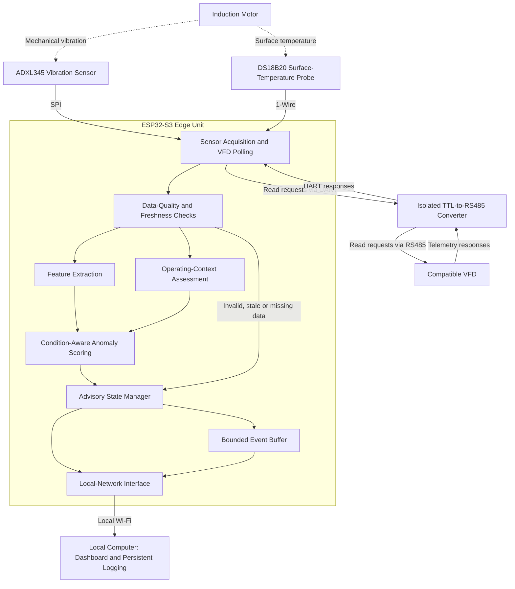
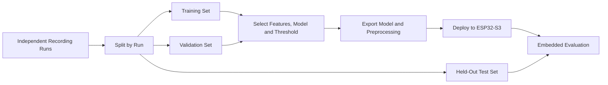

# VibraAid — System Architecture

> VIBRA: Variable-Condition Intelligent Motor Diagnostics Using Edge AI

| Field | Details |
|---|---|
| Project | VibraAid |
| Application ID | VK26-IITI-AHM-0402 |
| Theme | AI in Hardware & Manufacturing |
| Sub-theme | Predictive Maintenance & Machine Diagnostics |
| Document status | Proposed architecture; implementation and validation pending |

---

## 1. Architecture Objective

VibraAid is a proposed induction-motor monitoring system that combines
vibration, surface-temperature measurements, and available operating
context from a compatible variable-frequency drive (VFD).

The objective is to evaluate motor behaviour relative to its operating
condition rather than treating every signal change as a fault.

The system is intended to provide advisory information for maintenance
review. It does not control the motor or replace existing protection.

## 2. Design Scope

### Included in the Proposed First Prototype

- Three-axis vibration acquisition
- Motor-surface temperature monitoring
- Read-only acquisition of available VFD operating parameters
- Local data-quality checks
- Feature extraction and condition-aware anomaly scoring
- Explicit fault, unavailable, and out-of-range states
- Local-network dashboard and event logging

### Outside the Initial Scope

- Automatic motor start, stop, or speed control
- Safety-critical protection
- Direct acquisition of high-rate motor-current or voltage waveforms
- Validated identification of specific fault types
- Remaining useful life estimation
- Automatic online retraining
- Guaranteed performance on untested motors or operating conditions

## 3. Functional Architecture



This is a functional data-flow diagram, not a verified wiring schematic.

The firmware will issue only approved read requests to the VFD.
No motor-control register writes are included in this architecture.

## 4. Proposed Hardware

| Subsystem | Proposed Selection | Function |
|---|---|---|
| Edge controller | ESP32-S3-DevKitC-1 N8R8 | Acquisition, feature processing and inference |
| Vibration sensor | ADXL345 breakout with accessible SPI pins | Three-axis acceleration |
| Temperature sensor | DS18B20 probe | Motor-surface temperature |
| Telemetry interface | Isolated TTL-to-RS485 converter | Controller-to-VFD communication |
| Operating-context source | Compatible VFD with documented registers | Available drive-reported parameters |
| Power | Regulated low-voltage supply | Monitoring electronics |
| Monitoring host | Local computer running a Python dashboard | Visualization and persistent logging |
| Mechanical assembly | Enclosure, standoffs and rigid sensor mount | Protection and repeatable placement |

Exact variants, availability, electrical compatibility, mounting
arrangements, and power connections must be confirmed before assembly.

The motor, VFD, loading arrangement, guarding, and reference instruments
are separate test infrastructure.

## 5. Measurement Definitions

### 5.1 Vibration

The ADXL345 will measure acceleration at a documented mounting location.

Each recording must identify:

- Sensor orientation
- Attachment method
- Configured measurement range
- Output data rate
- Mounting location
- Any change in installation

The ADXL345 does not establish diagnostic coverage for every motor fault.
Coverage must be demonstrated through evaluation.

### 5.2 Temperature

The DS18B20 will measure temperature at its motor-surface attachment.

This measurement is not equivalent to internal winding temperature.

Probe contact, installation location, and thermal response must be
considered when interpreting trends.

### 5.3 VFD Operating Context

Only parameters documented for the selected VFD will be used.

Possible inputs include:

- Output frequency
- Drive-reported current
- Drive-reported voltage
- Operating status
- A documented load-related indicator, if available

Important limitations:

- VFD frequency is not a direct shaft-RPM measurement.
- A reported load indicator must not be treated as measured torque
  unless its meaning is explicitly established.
- Polled VFD telemetry is not high-rate electrical waveform acquisition.
- Motor-current signature analysis is not claimed for this design.
- Telemetry freshness and scaling must be validated.

## 6. Proposed Acquisition Settings

The following values are design targets, not measured results.

| Parameter | Proposed Setting |
|---|---|
| Vibration output rate | 1,600 samples/s per axis |
| SPI clock | 2 MHz |
| Vibration window | 2,048 samples per axis |
| Nominal window duration | 1.28 seconds |
| Initial window overlap | None |
| Temperature update | Approximately once per second |
| VFD polling | Approximately once per second, subject to drive limitations |
| Feature-processing and scoring target | ≤200 ms after a complete window is ready |

The vibration range will be selected during commissioning to avoid
clipping while retaining useful sensitivity.

The acquisition implementation must verify actual sample continuity.
Configured output rate alone does not prove reliable acquisition.

End-to-end alert latency includes:

1. Data-window acquisition
2. Scheduling and processing
3. Required telemetry availability
4. Persistence checks
5. Dashboard communication, where applicable

The processing target must not be presented as total alert latency.

## 7. Firmware Architecture

### 7.1 Acquisition Service

Responsibilities:

- Initialize sensors and communication interfaces.
- Acquire vibration into bounded buffers.
- Track sample counts and buffer overflow.
- Read temperature without blocking vibration acquisition.
- Poll approved VFD registers.
- Timestamp received data and communication outcomes.
- Report acquisition interruptions explicitly.

### 7.2 Data-Quality Service

Responsibilities:

- Detect missing or invalid sensor responses.
- Check vibration clipping and acquisition gaps.
- Reject invalid temperature readings.
- Track VFD telemetry age.
- Validate register decoding, units, and scaling.
- Prevent invalid data from producing a normal advisory state.

### 7.3 Feature-Extraction Service

Candidate features:

- Per-axis RMS acceleration
- Crest factor
- Kurtosis
- Selected spectral-band energy
- Surface temperature
- Temperature trend
- Available VFD operating-context values

Feature selection is provisional.

Preprocessing must define:

- Units and axis orientation
- Offset removal, where applicable
- Windowing for spectral processing
- Feature ordering
- Normalization parameters
- Handling of zero or near-zero denominators
- Treatment of missing inputs

Offline and embedded preprocessing must use the same definitions.

### 7.4 Operating-Context Service

Responsibilities:

- Interpret supported VFD parameters.
- Distinguish evaluated steady operation from transitions.
- Check whether an operating condition is within validated coverage.
- Identify missing or stale context.

Operating transitions must not automatically be classified as faults.
Their treatment will be established during validation.

### 7.5 Anomaly-Scoring Service

Responsibilities:

- Load the selected detector and configuration.
- Evaluate valid feature windows.
- Produce an anomaly score.
- Apply a threshold selected using validation recordings.
- Report model and configuration versions.

An anomaly score is not a calibrated probability of a named fault.

### 7.6 Advisory State Service

Responsibilities:

- Combine data validity, operating coverage, and anomaly information.
- Apply defined persistence and recovery rules.
- Produce an explicit advisory state.
- Record reasons for unavailable or abnormal states.
- Avoid silently replacing missing inputs with assumed normal values.

### 7.7 Communication Service

Responsibilities:

- Publish status over the proposed local-network link.
- Transfer buffered events when connectivity permits.
- Report connection state and dropped records.
- Keep network delays from blocking acquisition.

The dashboard protocol and message schema will be finalized during
implementation.

## 8. Model Development

### 8.1 Baseline

Develop a lightweight statistical detector as a reference.

Its performance will be compared with the proposed condition-aware
approach using the same held-out recordings and event definitions.

### 8.2 Candidate Edge-AI Model

Evaluate a small feature-based anomaly-detection model trained using
healthy recordings across approved operating conditions.

A conditional autoencoder is a candidate, not a finalized model.

Selection will consider:

- False-alert performance
- Detection performance on approved abnormal conditions
- Memory requirements
- Processing time
- Supported embedded operations
- Robustness to operating-condition changes

### 8.3 Offline-to-Embedded Workflow



### 8.4 Data-Separation Rules

- Split by independent recording run before creating overlapping windows.
- Keep windows from the same run in one partition.
- Fit normalization using training data only.
- Select thresholds using validation data.
- Keep the final test set separate from model selection.
- Document operating-condition coverage in each partition.

### 8.5 Deployment Rules

- Train models offline.
- Verify preprocessing consistency.
- Compare embedded outputs with offline outputs.
- Benchmark actual memory use and execution time.
- Freeze the evaluated model and baseline during testing.
- Do not automatically learn suspected abnormalities as healthy behaviour.

If the model exceeds available resources, evaluate a smaller model or
use the statistical baseline with clearly documented limitations.

## 9. Advisory States

| State | Condition | System Behaviour |
|---|---|---|
| Initializing | Startup checks or required inputs incomplete | Show unavailable status |
| Sensor Fault | Required sensor data missing or invalid | Suspend affected scoring |
| Context Unavailable | Required VFD context missing or stale | Suspend context-dependent scoring |
| Outside Validated Range | Valid inputs outside evaluated operating coverage | Avoid normal-condition claims |
| Within Learned Range | Valid inputs within coverage and below advisory criteria | Display current measurements |
| Inspection Advised | Persistent abnormality under valid conditions | Record event and request human review |

Data validity and operating coverage take precedence over normal or
abnormal scoring.

If several issues occur together, the event record should preserve all
relevant reasons even if the dashboard shows one primary state.

“Within Learned Range” does not guarantee that the motor is fault-free.

A reduced-input fallback detector must be separately validated before
it is enabled. Missing VFD context must not silently activate an
unvalidated vibration-only diagnosis.

## 10. Dashboard Architecture

The proposed dashboard will display:

- Device connection status
- Sensor and communication health
- Latest vibration features
- Surface-temperature trend
- Available VFD operating context
- Anomaly score and advisory state
- Measurement age
- Event history
- Model and configuration versions

The dashboard is an advisory interface.

Loss of dashboard connectivity must not stop local acquisition and
scoring, but it may interrupt remote visibility and persistent host logging.

## 11. Event Logging

### 11.1 Proposed Event Fields

```text
device_id
boot_id
event_sequence
timestamp_utc_if_synchronized
uptime_ms
sensor_status
communication_status
context_age_ms
operating_context
feature_values
anomaly_score
advisory_state
reason_codes
model_version
configuration_version
```

### 11.2 Storage Strategy

- Keep a bounded recent-event buffer on the controller.
- Persist received records on the dashboard computer.
- Define buffer size and overflow behaviour during implementation.
- Record dropped-event counts.
- Use boot identifiers and event sequences to identify resets and gaps.
- Do not claim loss-free logging across power interruptions.

Wall-clock timestamps must be marked unavailable until time is
synchronized. Uptime and sequence fields remain useful for ordering
events within a boot session.

### 11.3 Experimental Raw Data

Raw vibration recordings require a separately defined recording route.

The first prototype must not assume that all raw waveforms can be
retained in controller memory.

Recording procedures must preserve:

- Original measurements
- Acquisition settings
- Mounting information
- Motor and VFD identifiers
- Operating-condition metadata
- Known interruptions and data-quality flags

## 12. Mechanical Integration

The proposed assembly includes:

- Rigid sensor mounting near a selected bearing housing
- Repeatable sensor orientation
- Consistent temperature-probe attachment
- Short and secured sensor wiring
- Insulating controller supports
- Serviceable enclosure
- Cable strain relief
- Clear access to cooling openings and maintenance points

Final CAD must establish:

- Component fit
- Connector access
- Mounting-hole positions
- Bracket geometry
- Cable clearances
- Material choices
- Assembly sequence

Any stress calculations or FEA must state actual geometry, material,
constraints, load cases, and results.

AI-generated illustrations are conceptual aids. They are not CAD
exports, mechanical-analysis results, or fabrication evidence.

## 13. Electrical and Power Architecture

The proposed monitoring electronics use a regulated low-voltage supply.

Before assembly, verify:

- Development-board power-input requirements
- Supply connector compatibility
- Sensor breakout supply and logic levels
- Isolated converter supply requirements
- Total current demand and regulator capacity
- Pull-ups, decoupling, and protection components
- Safe startup and reset behaviour

The final schematic must show:

- Power distribution
- Signal connections
- Connector pin assignments
- Required supporting components
- Isolation boundary
- Protection provisions

No motor power terminal may be directly connected to controller circuitry.

## 14. Isolation and Safety Boundary

- Use a converter with documented isolation suitable for the reviewed setup.
- Preserve the manufacturer's isolation arrangement.
- Do not bridge controller-side and field-side grounds across the barrier.
- Review the complete installation, not only the converter module.
- Retain independent emergency stops, interlocks, and overload protection.
- Do not implement motor-control commands in the monitoring firmware.
- Install or adjust sensors only after approved equipment isolation.
- Use qualified supervision for motor/VFD work.
- Keep cables and brackets clear of rotating parts.
- Do not create unsafe faults for data collection.

VibraAid is an experimental monitoring project, not a certified
motor-protection or machine-safety system.

## 15. Failure Handling

| Failure | Intended Response |
|---|---|
| Vibration acquisition gap | Flag affected window and prevent misleading scoring |
| Invalid temperature input | Flag sensor fault; apply only a separately validated reduced-input mode |
| VFD timeout | Mark operating context unavailable |
| Condition outside coverage | Report outside validated range |
| Dashboard disconnection | Continue local processing; buffer events within capacity |
| Buffer overflow | Record dropped-data or dropped-event count |
| Controller reset | Restart checks; create a new boot identifier |
| Processing overload | Report missed deadlines; reduce workload only through documented configuration |

Fallback behaviour must be explicit, inspectable, and validated.

## 16. Validation Plan

| Area | Planned Evaluation |
|---|---|
| Acquisition | Actual sample continuity, timing and buffer overflow |
| Sensor installation | Mounting repeatability and clipping |
| Temperature | Valid readings, contact consistency and trend behaviour |
| VFD interface | Register meaning, scaling, serial settings and timeouts |
| Condition awareness | Healthy variation across approved operating conditions |
| Detection | Event-level precision, recall and false alerts per hour |
| Embedded processing | Memory use, processing latency and numerical consistency |
| Integration | Network loss, resets, stale data and event continuity |
| Mechanical assembly | Fit, retention, cable routing and temperature exposure |

Before testing, define:

- Safe test procedures
- Recording durations and repetitions
- Operating-condition coverage
- Event definitions
- Acceptance criteria
- Reference measurements
- Known limitations

Results must distinguish design targets from measured performance.

## 17. Open Design Decisions

The following remain subject to confirmation:

- Motor rating and approved loading arrangement
- VFD model and communication register map
- Exact isolated-interface variant
- Final schematic and protection components
- Power budget and connector arrangement
- Sensor mount and cable routing
- Final feature set and model
- Anomaly threshold and persistence rules
- Event-buffer capacity
- Dashboard communication protocol
- Approved abnormal-condition test procedures

## 18. Implementation Evidence

Completed work should be supported by:

- Native CAD files and dimensioned drawings
- Native schematic files
- BOM with exact variants and dated quotations
- Firmware source code
- Feature-processing and model-development code
- Genuine progress photographs and screenshots
- Raw recordings and acquisition metadata
- Test procedures and measured results

Repository commits document repository changes. They must not be
presented as proof of earlier fabrication or testing that did not occur.

## 19. Current Limitations

- Prototype integration and performance validation are pending.
- No diagnostic accuracy is established.
- No named-fault detection capability is established.
- No guaranteed prevention of motor failure is claimed.
- No maintenance-cost or downtime reduction is established.
- No safety certification or ingress rating is claimed.
- New motors, mounting arrangements, and operating ranges require evaluation.

## 20. Technical References

- [ESP32-S3-DevKitC-1 Documentation](https://docs.espressif.com/projects/esp-dev-kits/en/latest/esp32s3/esp32-s3-devkitc-1/index.html)
- [ADXL345 Datasheet](https://www.analog.com/media/en/technical-documen